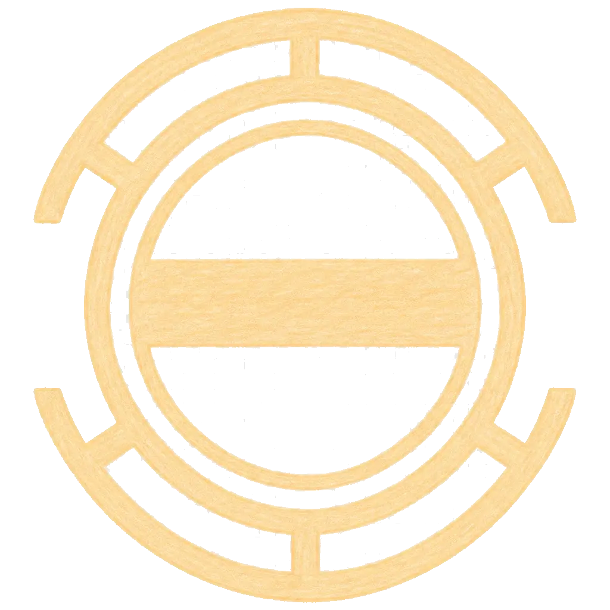

<h1 align="center">aoba</h1>

<strong>Multi-protocol debugging and simulation tool for Modbus RTU, for both physical serial ports and network-forwarded ports, with CLI and TUI interfaces.</strong>

<a href="docs/en/README.md"><strong>Full documentation (English)</strong></a>

This file is only an entry point: the documentation lives under [`docs/`](docs/en/README.md), one
directory per language, and it is what the documentation site is built from. Keeping a second copy
here would drift away from it, so the repository homepage routes instead of mirroring.

| Language | Documentation |
| --- | --- |
| English | [docs/en](docs/en/README.md) |
| 简体中文 | [docs/zh-Hans](docs/zh-Hans/README.md) |
| 繁體中文 | [docs/zh-Hant](docs/zh-Hant/README.md) |
| 日本語 | [docs/ja](docs/ja/README.md) |
| 한국어 | [docs/ko](docs/ko/README.md) |
| Français | [docs/fr](docs/fr/README.md) |
| Español | [docs/es](docs/es/README.md) |
| Русский | [docs/ru](docs/ru/README.md) |
| العربية | [docs/ar](docs/ar/README.md) |

License: SySL 1.0 — see [`LICENSE`](LICENSE).
